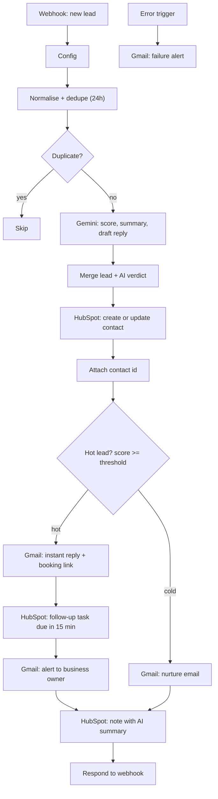

# AI Lead Response Automation (n8n)


An n8n workflow that answers every inbound lead within seconds. A lead arrives from a web form or ad platform, AI scores it, the lead is saved to a CRM, and a personalised reply with a booking link goes out right away. Hot leads also create a follow-up task and alert the business owner. Cold leads get a softer nurture email.

> **Why this exists:** small businesses lose leads by replying too slowly. This workflow makes sure no enquiry waits for a human to notice it.

---

## How it works



1. **Capture:** a webhook accepts a lead from any form, ad platform, or CRM.
2. **Normalise and dedupe:** field names are standardised (`name`, `email`, `phone`, `service`, `message`, ...), and the same email or phone seen within 24 hours is skipped.
3. **Qualify:** Google Gemini returns a score (0 to 100), a verdict (hot, warm, or cold), a one-sentence summary, and a draft reply.
4. **Record:** the contact is created or updated in HubSpot (matched on email).
5. **Branch on score:** at or above `hot_threshold`, the lead is hot.
   - **Hot:** instant email reply with your booking link, a HubSpot follow-up task due in 15 minutes, and an alert email to the owner.
   - **Cold:** a friendly nurture email with the booking link.
6. **Log:** a HubSpot note stores the AI verdict, summary, and the lead's original message.
7. **Fail loudly:** a separate error flow emails you if any run fails.

## Tech stack

| Layer | Tool |
|---|---|
| Orchestration | [n8n](https://n8n.io) (Cloud or self-hosted) |
| AI scoring and drafting | Google Gemini (via n8n's Google Gemini node) |
| CRM | HubSpot (contacts, tasks, notes) |
| Email | Gmail |
| Scheduling | Cal.com booking link |

## Prerequisites

- An n8n instance (Cloud trial or self-hosted Community Edition)
- A Google account (Gmail sending) and a Gemini API key, or n8n Cloud's included credits where offered
- A HubSpot account
- A Cal.com account and your public booking link

## Setup

### 1. Import the workflow
In n8n go to **Workflows → Import from File** and select the workflow JSON.

### 2. Create credentials
| Credential | Used by | Notes |
|---|---|---|
| Google Gemini | AI node | Free tier is fine for demos. Use a paid API for real client data (see [Privacy](#privacy-and-compliance)). |
| Gmail (OAuth2) | Reply, nurture, owner alert, error alert | Emails are sent from the connected account. |
| HubSpot | Contact and task nodes | Connect through n8n's HubSpot credential. |
| HubSpot service key | Note node (HTTP Request) | Create under **Development → Keys → Service keys**, then add it as a **Header Auth** credential: name `Authorization`, value `Bearer <key>`. |

### 3. Fill in the Config node
| Field | Example | Purpose |
|---|---|---|
| `brand` | `Bright Smile Dental` | Business name used in sign-offs |
| `hot_threshold` | `70` | Score at or above which a lead counts as hot |
| `booking_link` | `https://cal.com/your-name/15min` | Link included in replies |
| `owner_email` | `owner@example.com` | Where hot-lead alerts go |
| `test_mode` | `true` | When `true`, every outbound email goes to `test_email` instead of the lead |
| `test_email` | `you@example.com` | Your own address for safe testing |
| `base` | *(ignore)* | Leftover placeholder from the original template |

**Keep `test_mode` on until you are fully ready.** Every outbound email node should read it.

### 4. Test it
Click **Listen for test event** on the Webhook node, then send a lead.

**PowerShell**
```powershell
$body = @{
  name    = "Jane Smith"
  email   = "jane@example.com"
  phone   = "+15551234567"
  message = "I need a quote for a new AC unit, ideally this week."
  source  = "website_form"
} | ConvertTo-Json

Invoke-RestMethod -Uri "YOUR_TEST_URL" -Method Post -ContentType "application/json" -Body $body
```

**curl (macOS / Linux / Git Bash)**
```bash
curl -X POST "YOUR_TEST_URL" \
  -H "Content-Type: application/json" \
  -d '{"name":"Jane Smith","email":"jane@example.com","phone":"+15551234567","message":"I need a quote for a new AC unit, ideally this week.","source":"website_form"}'
```

Try a hot message ("need repair today, budget $3k") and a cold one ("just browsing"), and confirm each takes the right branch.

### 5. Go live
1. Add **Header Auth** to the Webhook node so strangers can't trigger it.
2. **Publish** the workflow and use the **Production URL** (`/webhook/...`), not the Test URL (`/webhook-test/...`).
3. Send a real form submission with `test_mode` still on, then switch it off when the emails behave correctly.

## Accepted lead fields

The normalise step maps common field names, so most forms work without changes:

| Standard field | Also accepted |
|---|---|
| `name` | `full_name`, or `first_name` + `last_name` |
| `email` | |
| `phone` | `phone_number` |
| `service` | `interest`, `form_name` |
| `message` | `notes`, `comments` |
| `source` | `utm_source` |
| `company`, `budget` | |

A lead needs at least an email or a phone number, or it is rejected.

## Known limitations

- **Duplicate detection only works on a published workflow.** It uses n8n workflow static data, which as far as I know is not saved during manual test runs. To test it, publish the workflow, send the same lead twice to the production URL, and check the **Executions** tab.
- **A duplicate resets the 24-hour clock**, and a lead is marked as seen even if a later step fails.
- **If the AI reply can't be parsed, the lead is scored 0** and treated as cold. Check `ai.summary` for "AI parse failed" while testing.
- **The Gemini model in use is a preview version.** Switch to a stable model before using this for clients.
- **Email only.** The original template also supports SMS and WhatsApp, but those channels aren't configured here.
- **The voice-agent branch is not configured.** It is inherited from the source template and unused.

## Privacy and compliance

- Free AI tiers may use prompts to improve their models. Use paid API access before processing real client data.
- Only email people who have submitted a form and agreed to be contacted. Add consent wording to the form.
- If you extend this to **SMS** in the US, you need Twilio A2P 10DLC registration and TCPA-compliant consent. If you add a multi-day marketing sequence, check CAN-SPAM requirements (unsubscribe option and physical address).
- Do not store API keys, tokens, or real lead data in this repository.

## Credits and licence

This project adapts the template **"Score inbound leads with AI, reply by SMS or WhatsApp, book calendar slots and alert sales"** from the community collection [enescingoz/awesome-n8n-templates](https://github.com/enescingoz/awesome-n8n-templates). That collection states its templates were found online and belong to their original creators. This repository contains my own modifications and documentation, and I don't claim ownership of the original template.

> **Before publishing the workflow JSON:** confirm you are allowed to redistribute the original template. If unsure, publish only this documentation and your own screenshots and describe the changes you made. Also strip **pinned data** (it can contain IP addresses and headers) and any credential details from the export.

Licence: *choose one for your own changes (for example MIT) and add a `LICENSE` file.*

## Author

**Sharon Wainaina**, systems and automation. [LinkedIn](#) · [Email](#)

Demo video: *add link here*
